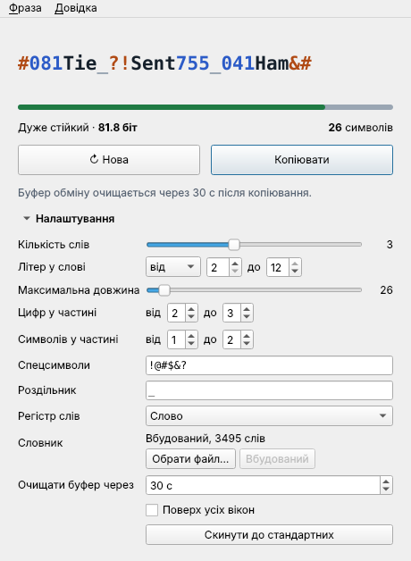
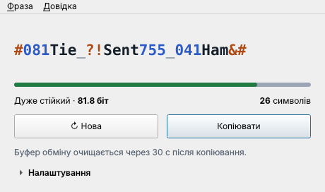
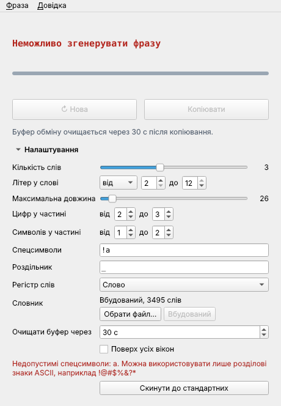

# Passgen: посібник користувача

Passgen генерує парольні фрази на кшталт `&!519Deck_449Lip&_867$Wine`: кілька англійських слів, цифри та спецсимволи. Такі фрази легше прочитати й передрукувати, ніж випадковий набір символів, а стійкість у них така сама висока.



## Зміст

1. [Встановлення](#встановлення)
2. [Головне вікно](#головне-вікно)
3. [Налаштування](#налаштування)
4. [Як читати стійкість](#як-читати-стійкість)
5. [Буфер обміну](#буфер-обміну)
6. [Власний словник](#власний-словник)
7. [Гарячі клавіші](#гарячі-клавіші)
8. [Де зберігаються налаштування](#де-зберігаються-налаштування)
9. [Консольний режим](#консольний-режим)
10. [Поради з безпеки](#поради-з-безпеки)
11. [Часті питання](#часті-питання)

## Встановлення

Готові файли лежать на сторінці [Releases](https://github.com/mykhailoshchavinskyi/password_generator/releases/latest). Встановлювати Python не потрібно.

| Система | Файл | Як запустити |
|---|---|---|
| Windows 10/11 | `Passgen-<версія>-windows-x64.exe` | Запустіть файл. Встановлення не потрібне. |
| macOS на Apple M1–M4 | `Passgen-<версія>-macos-arm64.dmg` | Відкрийте .dmg і перетягніть Passgen у «Програми». |
| macOS на Intel | `Passgen-<версія>-macos-x64.dmg` | Так само. |
| Linux | `Passgen-<версія>-linux-x64.AppImage` | `chmod +x Passgen-*.AppImage`, потім запустіть файл. |
| Linux, без AppImage | `Passgen-<версія>-linux-x64.tar.gz` | Розпакуйте й запустіть `Passgen/Passgen`. |

Цілісність завантаженого файлу можна звірити з `SHA256SUMS.txt` з того самого релізу:

```sh
sha256sum Passgen-1.0.0-linux-x64.AppImage           # Linux
shasum -a 256 Passgen-1.0.0-macos-arm64.dmg          # macOS
Get-FileHash Passgen-1.0.0-windows-x64.exe           # Windows PowerShell
```

### Перший запуск на Windows

Файл не підписаний сертифікатом розробника, тому Windows SmartScreen може показати «Windows захистив ваш ПК». Натисніть **Докладніше → Виконати все одно**.

### Перший запуск на macOS

Програма не нотаризована Apple, тому під час першого запуску macOS повідомить, що не може перевірити розробника. Відкрийте **Системні параметри → Конфіденційність і безпека**, знайдіть повідомлення про Passgen і натисніть **Все одно відкрити**. Достатньо зробити це один раз.

### Встановлення з вихідного коду

Потрібен Python 3.10 або новіший.

```sh
pip install git+https://github.com/mykhailoshchavinskyi/password_generator.git
passgen        # вікно
passgen-cli    # консольний режим
```

## Головне вікно



| Елемент | Що робить |
|---|---|
| Фраза | Поточна парольна фраза. Слова, цифри й спецсимволи виділені різними кольорами. Клік по фразі копіює її. |
| Шкала і «Дуже стійкий · 81.8 біт» | Стійкість генератора з поточними налаштуваннями. Детальніше в розділі [Як читати стійкість](#як-читати-стійкість). |
| «26 символів» | Довжина саме цієї фрази. |
| **↻ Нова** | Згенерувати іншу фразу з тими самими налаштуваннями. |
| **Копіювати** | Скопіювати фразу в буфер обміну. |
| Рядок під кнопками | Скільки секунд лишилося до очищення буфера обміну. |
| **Налаштування** | Розгорнути або згорнути параметри. Вікно запам'ятовує цей стан. |

Будь-яка зміна налаштувань одразу генерує нову фразу.

## Налаштування

Кожна фраза складається з **частин**, з'єднаних роздільником. Частина має три блоки: слово, цифри, спецсимволи. Порядок блоків у кожній частині випадковий: `Deck449&`, `&!519Deck`, `449&Deck` тощо.

| Параметр | За замовчуванням | Межі | Пояснення |
|---|---|---|---|
| Кількість слів | 3 | 1–6 | Скільки частин у фразі. Найсильніше впливає на стійкість. |
| Літер у слові | від 2 до 12 (без обмеження) | 2–12 | **рівно** N — усі слова мають рівно N літер; **від … до …** — довжина кожного слова в цих межах. У вбудованому словнику слова мають 3–7 літер. |
| Максимальна довжина | 26 | від мінімально можливої до 128 | Фраза ніколи не буде довшою. Повзунок не дає вибрати значення, менше за мінімально можливу довжину для інших параметрів. |
| Цифр у частині | від 2 до 3 | 0–6 | Скільки цифр у кожній частині. 0 означає, що цифр може не бути. |
| Символів у частині | від 1 до 2 | 0–4 | Скільки спецсимволів у кожній частині. |
| Спецсимволи | `!@#$&?` | розділові знаки ASCII | Набір, з якого беруться спецсимволи. Повтори ігноруються. Якщо сайт приймає лише певні символи, вкажіть тут саме їх. |
| Роздільник | `_` | 0–3 символи | Що ставиться між частинами. Може бути порожнім. |
| Регістр слів | Слово | Слово, слово, СЛОВО | Як записувати слова. На стійкість не впливає. |
| Словник | Вбудований, 3495 слів | | Див. [Власний словник](#власний-словник). |
| Очищати буфер через | 30 с | не очищати, 1–300 с | Див. [Буфер обміну](#буфер-обміну). |
| Поверх усіх вікон | вимкнено | | Вікно Passgen лишається над іншими вікнами. Зручно, коли заповнюєте форму реєстрації. |

**Скинути до стандартних** повертає всі параметри до значень із таблиці.

Якщо параметри несумісні, наприклад у полі спецсимволів є літера, замість фрази з'явиться «Неможливо згенерувати фразу», а під налаштуваннями буде червоне пояснення, що виправити.



### Як параметри впливають на стійкість

- **+1 слово** додає приблизно 25–30 біт: найефективніший спосіб посилити фразу. Якщо фраза перестає вміщатися, повзунок максимальної довжини сам підніметься.
- **Більша максимальна довжина** дозволяє довші слова й більше цифр, тому трохи підвищує стійкість.
- **Ширші діапазони цифр і символів** та **більший набір спецсимволів** теж додають біти, але менше.
- **Обмеження літер у слові** зменшує кількість придатних слів, а отже й стійкість. Наприклад, рівно 5 літер при довжині 26 дає близько 64 біт замість 82. Щоб повернути стійкість, додайте слово або збільште максимальну довжину.
- **Регістр** і **роздільник** на стійкість не впливають, бо вони однакові в усіх частинах.

## Як читати стійкість

Стійкість вимірюється в **бітах**. *N* біт означає, що зловмиснику треба перебрати близько 2<sup>N</sup> варіантів. Кожен додатковий біт подвоює кількість спроб.

На шкалі показано **стійкість генератора**: скільки варіантів доведеться перебрати, якщо зловмисник знає всі ваші налаштування, крім самої фрази. Це чесна оцінка: Passgen вибирає фразу рівномірно серед усіх можливих, тож жодна з них не ймовірніша за інші.

| Біт | Оцінка | Колір | Для чого підходить |
|---|---|---|---|
| менше 45 | Слабкий | червоний | Не рекомендується. |
| 45–59 | Середній | жовтий | Малоцінні облікові записи з обмеженням кількості спроб входу. |
| 60–79 | Стійкий | зелений | Звичайні облікові записи. |
| від 80 | Дуже стійкий | зелений | Майстер-пароль, шифрування, пошта, банк. |

Якщо навести курсор на напис зі стійкістю, з'явиться ще одне число: стійкість **конкретної фрази**, навіть якщо зловмисник знає її точний шаблон (довжини слів, кількість цифр і символів, порядок блоків). Воно трохи менше за стійкість генератора.

## Буфер обміну

Після копіювання Passgen через заданий час (за замовчуванням 30 с) очищає буфер обміну, щоб пароль не лишався там надовго. Буфер очищається, лише якщо в ньому досі ваша фраза: якщо ви вже скопіювали щось інше, Passgen його не чіпає. Під час закриття програми буфер також очищається.

Passgen просить менеджери буфера обміну не зберігати фразу в історії: журнал буфера Windows (Win+V), KDE Klipper і менеджери для macOS, що підтримують цю позначку. Сторонні програми можуть цю позначку ігнорувати.

## Власний словник

Замість вбудованого словника можна підключити свій: **Налаштування → Словник → Обрати файл…**.

Вимоги до файлу:

- текстовий файл у кодуванні UTF-8;
- слова через пробіл або по одному в рядку;
- слово складається з 2–12 латинських літер, решта ігнорується;
- щонайменше 50 різних придатних слів.

Регістр у файлі не важливий, повтори відкидаються. Стійкість зростає з розміром словника: словник удвічі більший додає по 1 біту на кожне слово. Кнопка **Вбудований** повертає стандартний словник.

Вбудований словник містить 3495 поширених англійських слів довжиною 3–7 літер. З нього прибрано образливі та чутливі слова, власні назви й вигуки.

## Гарячі клавіші

| Клавіші | Дія |
|---|---|
| Ctrl+R або F5 | Нова фраза |
| Ctrl+Shift+C | Копіювати фразу |
| F1 | Відкрити цей посібник |
| Ctrl+Q | Вихід |

На macOS замість Ctrl використовується ⌘.

## Де зберігаються налаштування

Налаштування зберігаються у файлі `settings.json`:

| Система | Шлях |
|---|---|
| Windows | `%APPDATA%\passgen\settings.json` |
| macOS | `~/Library/Application Support/passgen/settings.json` |
| Linux | `~/.config/passgen/settings.json` (або `$XDG_CONFIG_HOME/passgen`) |

Якщо видалити файл, програма запуститься зі стандартними налаштуваннями. **Згенеровані фрази ніде не зберігаються** і не передаються мережею: Passgen взагалі не звертається до інтернету, крім кнопки F1, яка відкриває цей посібник у браузері.

## Консольний режим

Якщо Passgen встановлено з вихідного коду, доступна команда `passgen-cli`. Вона сумісна з початковим скриптом `passgen.py`:

```sh
passgen-cli                       # 10 фраз за стандартними налаштуваннями
passgen-cli -n 5 --max-len 30     # 5 фраз до 30 символів
passgen-cli --words 4 --digits 1-2 --symbols 1 --symbol-set '!?' --sep -
passgen-cli --word-len 5          # кожне слово рівно з 5 літер
passgen-cli --word-len 4-6        # слова від 4 до 6 літер
passgen-cli --case upper --wordlist my-words.txt
passgen-cli -n 1 --plain          # лише фраза, без таблиці (зручно для скриптів)
```

`passgen-cli --help` показує всі параметри.

## Поради з безпеки

- Використовуйте окрему фразу для кожного сайту.
- Зберігайте фрази в менеджері паролів, а не в текстовому файлі.
- Для майстер-пароля беріть 4–5 слів і максимальну довжину від 40.
- Не змінюйте згенеровану фразу «на свій смак»: передбачувані зміни знижують стійкість.
- Якщо сайт обмежує довжину пароля, зменшіть максимальну довжину і перевірте, що стійкість лишилась від 60 біт.

## Часті питання

**Шкала червона, хоча фраза виглядає складною.** Найчастіше вибрано 1 слово (близько 30 біт). Збільште кількість слів до 3 або більше: 3 слова при довжині 26 дають близько 82 біт.

**Не можу зменшити максимальну довжину.** Повзунок не опускається нижче мінімально можливої довжини. Зменште кількість слів, цифр або символів, або вкоротіть роздільник.

**Сайт не приймає якийсь символ.** Залиште в полі «Спецсимволи» лише ті символи, які сайт дозволяє.

**Сайт вимагає пароль без спецсимволів.** Встановіть «Символів у частині» від 0 до 0. Поле спецсимволів тоді можна залишити порожнім.

**AppImage не запускається: «FUSE»/«libfuse.so.2».** Запустіть так: `./Passgen-*.AppImage --appimage-extract-and-run`, або встановіть пакет `libfuse2` (`libfuse2t64` в Ubuntu 24.04+).

**macOS пише, що програма пошкоджена.** Таке буває, якщо браузер додав до файлу атрибут карантину. Виконайте `xattr -dr com.apple.quarantine /Applications/Passgen.app`.

**Як повністю видалити програму?** Видаліть файл програми та теку з налаштуваннями (див. [Де зберігаються налаштування](#де-зберігаються-налаштування)).
